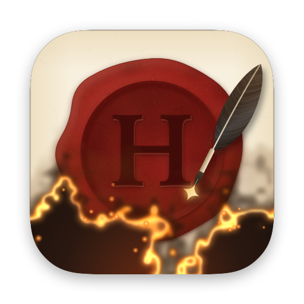
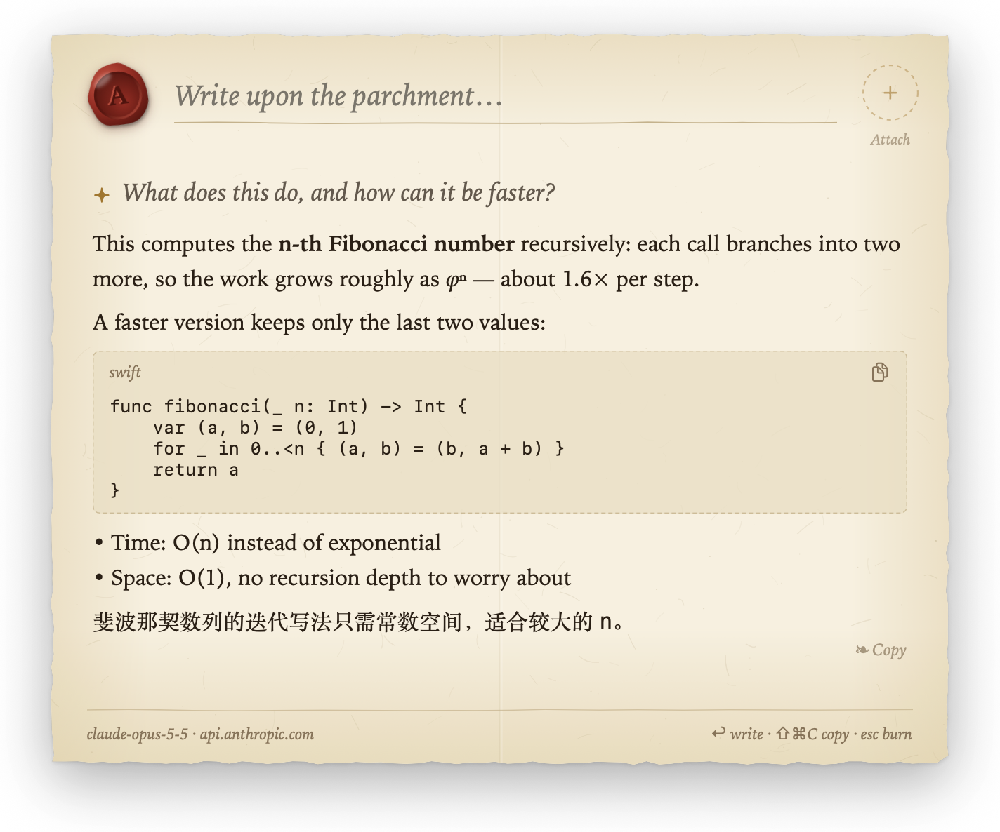
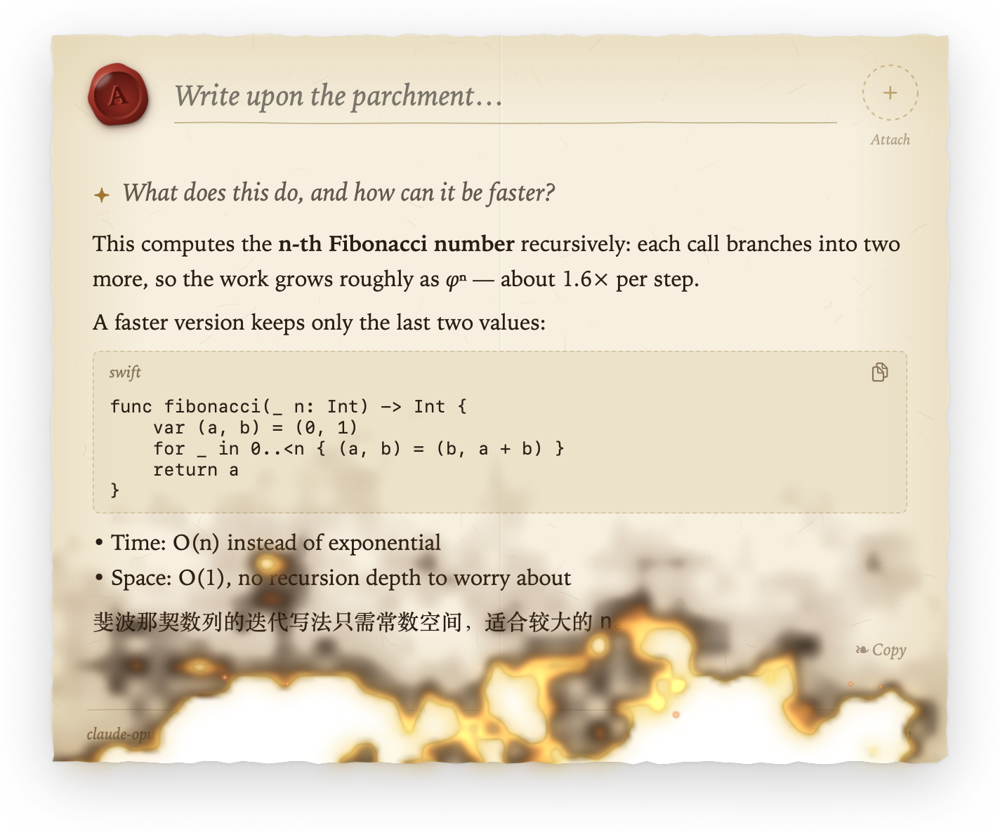
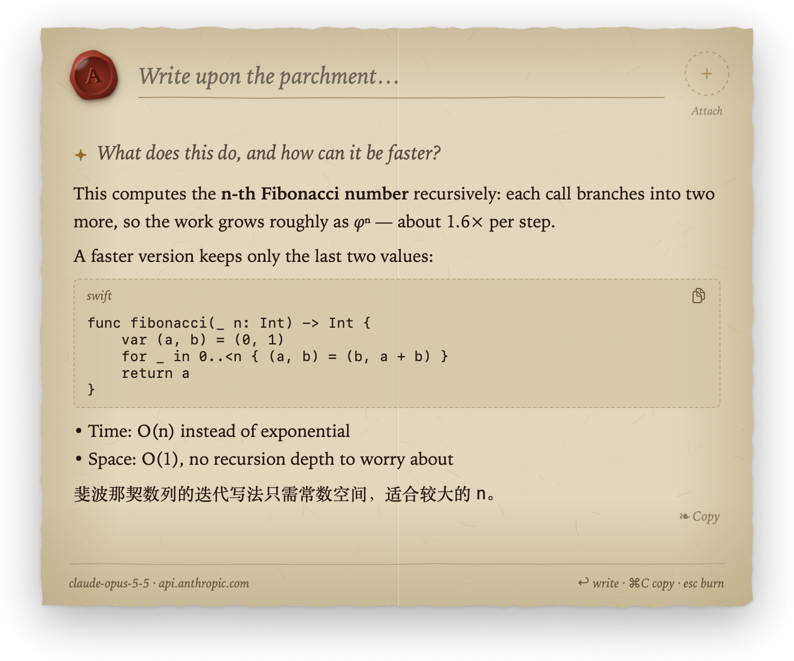
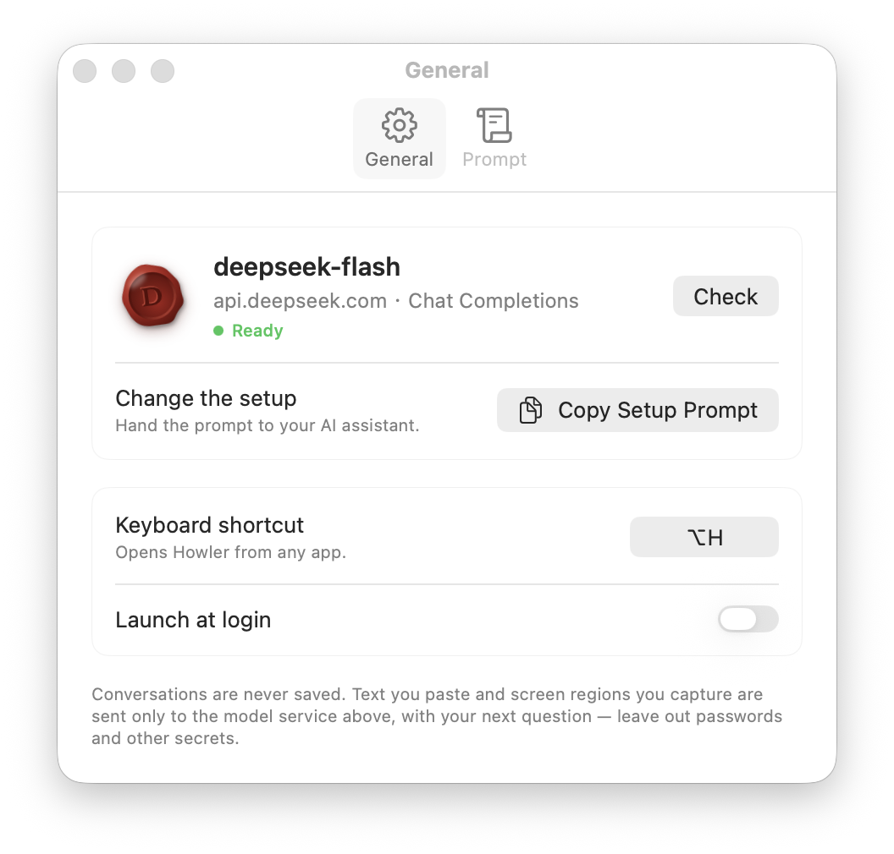

<p align="center">
  
</p>

<h1 align="center">Howler</h1>

<p align="center">
  <strong><em>Burn after reading. · 阅后即焚</em></strong>
</p>

<p align="center">
  macOS 上一封用火漆封着的信，专门用来问小问题。<br>
  在羊皮纸上写下问题，羽毛笔把回答写在下面；读完，信就烧掉。
</p>

<p align="center">
  <a href="https://github.com/HiAriesZhou/Howler/releases"></a>
  <a href="https://github.com/HiAriesZhou/Howler/actions/workflows/build.yml"></a>
  
  
  
  <a href="LICENSE"></a>
</p>

<p align="center">
  <a href="https://howler.arieszhou.com">官网</a> · <a href="README.md">English</a> · <strong>简体中文</strong>
</p>

<p align="center">
  
</p>

---

## 一封信

在任何应用里按 **⌥H**，一封封好火漆的信就落在屏幕上方。

- **一张纸，不是输入框**：毛边、纤维纹理、中间一道折痕。问题写在横线上，回答用书卷字体写在下方。纸随回答向下展开，最长到 A4 比例，之后跟着羽毛笔滚动。
- **羽毛笔书写**：回答按手写的节奏逐字出现，新墨先泛起金光，再沉为墨色，羽毛笔停在最后一个字后面。模型思考时，羽毛笔悬在纸上，并显示已经思考了几秒。
- **火漆印**：左上角的深红火漆印标明是哪个模型在回信。粘贴长文本或图片，或者截取屏幕区域，内容会封进右上角刻着符文的琥珀色火漆印，不会塞进问题里。
- **阅后即焚**：按 Esc 或点击纸外，信纸从底边起火，焦痕、火光和火星一路烧到火漆印，这次对话也随之烧掉，什么都不保存。

<table>
  <tr>
    <td width="50%"></td>
    <td width="50%"></td>
  </tr>
  <tr>
    <td align="center"><em>按下 Esc，信纸燃起</em></td>
    <td align="center"><em>深色模式下的烛光纸张</em></td>
  </tr>
</table>

开启“减少动态效果”后，落纸、盖章、墨光和燃烧都不再播放，文字随到随显。

## 安装

1. [下载 **Howler.dmg**](https://github.com/HiAriesZhou/Howler/releases/latest/download/Howler.dmg)，打开后把 Howler 拖到 Applications。旧版本与 `Howler.zip`（同一个应用）在 [Releases](https://github.com/HiAriesZhou/Howler/releases)。
2. 打开 Howler。应用使用 Developer ID 签名并经过 Apple 公证，可以像其他应用一样直接打开。更新后，钥匙串和录屏权限都会保留。
3. 菜单栏会出现一枚刻着 H 的小火漆印。Howler 没有 Dock 图标。

v0.1.4 之前的版本是 ad-hoc 签名，如果被 Gatekeeper 拦截，可以在 Finder 中右键点 Howler，选**打开**。

## 配置模型

Howler 只连接一个模型服务。配置步骤很少，可以直接交给 AI 助手完成。

<p align="center">
  
</p>

打开 **Settings › Copy Setup Prompt**，把复制的提示词粘贴给 Claude Code、Codex 等能运行命令的 AI 助手。它会问你想用哪家服务、哪个模型，查官方文档，写入配置，然后检查直到通过。它不会让你把 API Key 发到聊天里：需要 Key 时，它请你先复制，再运行 `pbpaste | Howler config set api-key --stdin`，Key 直接存进钥匙串。

同样的命令你也可以自己运行，它们就在应用本身的可执行文件里：

```bash
H=/Applications/Howler.app/Contents/MacOS/Howler
$H config schema                                    # 全部字段与示例
$H config set preset=deepseek 'body={"thinking":{"type":"disabled"}}'
pbpaste | $H config set api-key --stdin             # 也可 --env NAME、--file PATH
$H check                                            # 加 --verbose 查看请求（Key 已遮盖）
$H config show
```

| 字段 | 含义 |
| --- | --- |
| `format` | `chat-completions`（OpenAI 及兼容接口，含本机 Ollama / LM Studio）、`anthropic-messages`、`gemini-generate-content` |
| `base-url` | API 地址，不含端点路径；必须是 `https://`，本机 `http://localhost` 除外 |
| `model` | 服务里的模型名 |
| `body` | 合并进每个请求的 JSON，例如关闭思考、限制输出长度 |
| `headers` | 额外的请求头，不能放 Key |
| `preset` | `openai`、`anthropic`、`gemini`、`xai`、`deepseek`、`openrouter`：一次填好前三个字段 |

改动会立即在正在运行的 Howler 中生效。请求直接发往你配置的服务，不经过任何中转。

### 系统提示词

每次对话开头都会带一段简短的系统提示词，完整内容在 **Settings › System Prompt** 里可以看到：

- **UTC 日期**，例如 `Current date: 2026-10-29 (UTC).`。没有它，模型会把训练截止时间当成今天。UTC 不透露你的时区或所在地。这一行由 Howler 添加，不能编辑。
- **指令**，可以编辑。建议的指令要求回答简短、不用表格（信纸显示不了表格），并用提问的语言回答。点 **Reset** 恢复建议内容。

清空指令会关闭整段系统提示词，连日期也不发送，适用于不接受系统提示词的模型。如果 `body` 里设置了 `system`（Anthropic）或 `systemInstruction` / `system_instruction`（Gemini），会替换掉这段提示词。

模型不能联网搜索，只能凭训练数据回答。日期的作用是让它知道某件事可能太新、它不知道。

## 使用

| | |
| --- | --- |
| **⌥H** | 呼出信纸；再按一次烧掉。可在 Settings 中改成其他快捷键 |
| **↩** / **⌥↩** | 发送 / 换行 |
| **⇧⌘C** | 复制最新一条回答（也可点 ❧ Copy） |
| **+ Attach** | 从剪贴板粘贴，或截取屏幕区域 |
| **⌘V** | 短文字进入问题；长文字或图片封成附件 |
| **Esc** / 点击纸外 | 烧掉信纸，连同这次对话 |

追问写在同一张纸上，每轮之间用花饰隔开。点 ⏹ 可以停止回答，已经写下的内容会保留。附件只随下一个问题发出，请不要粘贴或截取密码、密钥等敏感信息。首次截屏需要授予“录屏与系统录音”权限。

## 隐私

- 从不保存对话：消息只在内存里，信纸烧掉就没了。
- 只持久化这些：模型配置、最近一次检查结果、系统提示词的指令、快捷键（UserDefaults），以及 API Key（钥匙串）。
- 系统提示词只带 UTC 日期，不含任何关于你的信息：没有名字、语言设置、时区或所在地。
- 只在你粘贴或截屏时读取剪贴板和屏幕。
- 不记录日志，没有统计或遥测；网络请求使用 ephemeral `URLSession`。
- 命令行从不打印 Key。

## 从源码构建

需要 Xcode 15.3+（Swift 5.10+）和 macOS 14+，没有第三方依赖。

```bash
make test   # 单元测试：配置、请求、流式解析、附件、快捷键、书写节奏
make app    # universal 构建，生成 build/Howler.zip，应用放在 build/stage.noindex（ad-hoc，或用 SIGN_IDENTITY 签名）
make dmg    # 同一个应用打成 build/Howler.dmg，附 Applications 快捷方式
make run    # 构建并打开
make icon   # 由 Sources/Howler/AppIconArt.swift 重新渲染 Resources/AppIcon.icns
```

调试构建自带演示模式，不需要 Key，也不联网：

```bash
swift build
HOWLER_DEMO=1 .build/debug/Howler          # 其他变体：long、multi、burn、image、setup、settings
HOWLER_DEMO_DARK=1 HOWLER_DEMO=1 .build/debug/Howler
```

改应用名或 Bundle ID：修改 [`app.config`](app.config) 后重新构建。发布：在同一文件里改好 `VERSION`，推送同名的 `v` tag，CI 会自动测试、构建、签名、公证并发布 Release（见 [release signing](docs/release-signing.md)）。手动验收清单见 [ACCEPTANCE.md](ACCEPTANCE.md)。

<details>
<summary>从 Napkin 或 QuickAsk 升级</summary>

项目依次从 QuickAsk、Napkin 改名为 Howler，GitHub 仓库也一起改了名。旧的本地克隆请执行 `git remote set-url origin git@github.com:HiAriesZhou/Howler.git`。新的 Bundle ID `com.hiarieszhou.howler` 和 `com.hiarieszhou.napkin`、`io.github.hiarieszhou.quickask` 互不相通，升级后需要重新配置模型。请删除旧应用，否则它们会争抢 ⌥Space。旧的钥匙串条目可以在“钥匙串访问”中搜索旧 Bundle ID 后删除。
</details>

---

<p align="center">
  <sub>图标和火漆都用代码绘制，材质与信纸里的纸、蜡、火一致；服务商标记使用单色字母与 SF Symbols，没有打包任何商标 Logo。<br>
  MIT 许可证 · © 2026 AriesZhou</sub>
</p>
