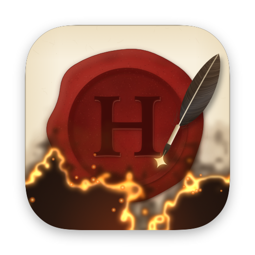
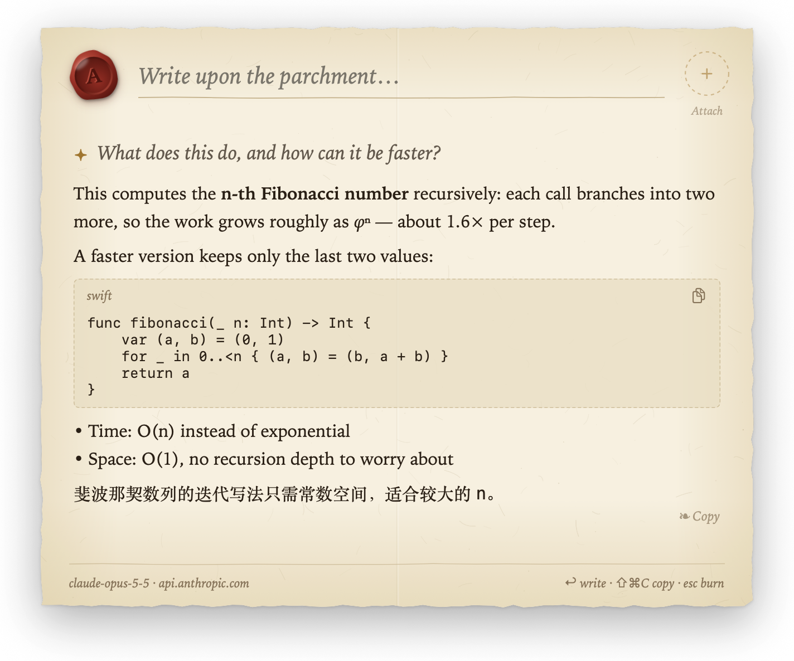
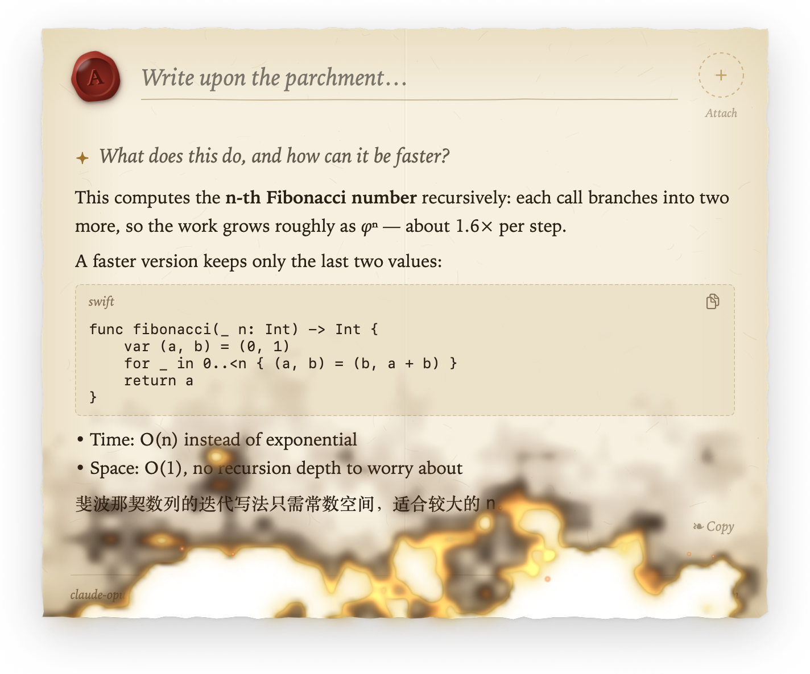
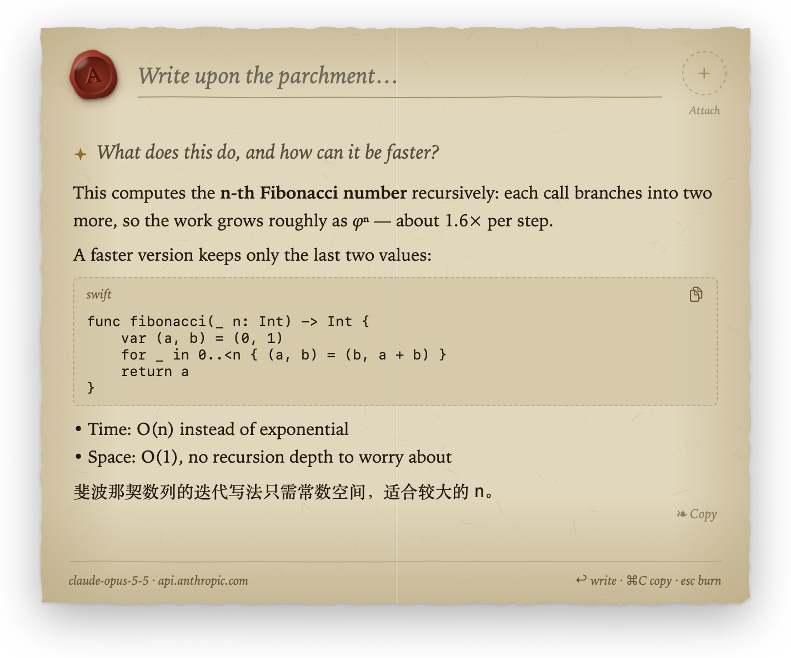
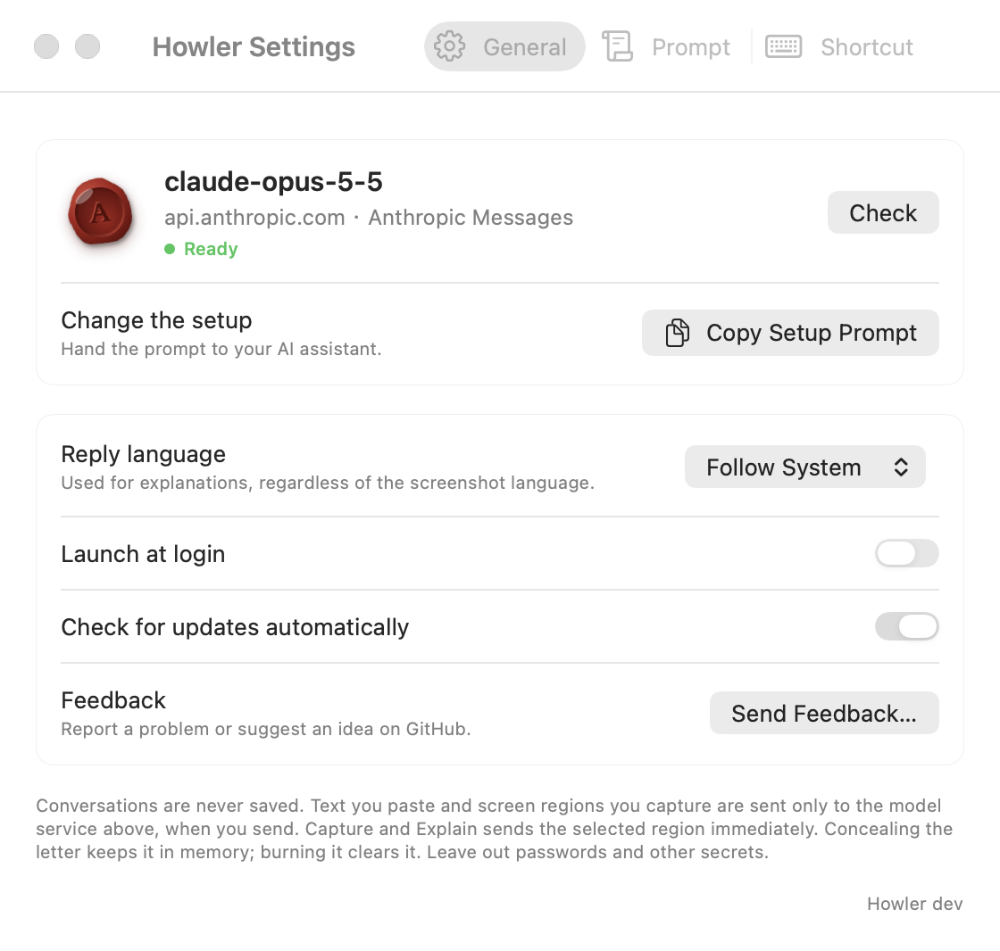

<p align="center">
  
</p>

<h1 align="center">Howler</h1>

<p align="center">
  <strong><em>Burn after reading. · 阅后即焚</em></strong>
</p>

<p align="center">
  macOS 上一封用火漆封着的信，专门用来问小问题。<br>
  在羊皮纸上写下问题，羽毛笔把回答写在下面；读完，信就烧掉。
</p>

<p align="center">
  <a href="https://github.com/HiAriesZhou/Howler/releases"></a>
  <a href="https://github.com/HiAriesZhou/Howler/actions/workflows/build.yml"></a>
  
  
  
  <a href="LICENSE"></a>
</p>

<p align="center">
  <a href="https://howler.arieszhou.com">官网</a> · <a href="README.md">English</a> · <strong>简体中文</strong>
</p>

<p align="center">
  
</p>

---

## 一封信

在任何应用里按 **⌥H**，一封封好火漆的信就落在屏幕上方。

- **一张纸，不是输入框**：毛边、纤维纹理、中间一道折痕。最新一轮问题和回答紧贴输入框下方，旧对话依次排在下面。纸随回答向下展开，达到 A4 比例或屏幕可用高度后保持不动，继续写出的内容留在下方。向下滚动可继续阅读，发送问题时回到顶部。
- **羽毛笔书写**：回答按手写的节奏逐字出现，新墨先泛起金光，再沉为墨色，羽毛笔停在最后一个字后面。模型思考时，羽毛笔悬在纸上，并显示已经思考了几秒。
- **火漆印**：左上角的深红火漆印标明是哪个模型在回信。粘贴长文本或图片，或者截取屏幕区域，内容会封进右上角刻着符文的琥珀色火漆印，不会塞进问题里。
- **阅后即焚**：按 Esc 或点击右下角的火焰，信纸从底边起火，焦痕、火光和火星一路烧到火漆印，这次对话也随之烧掉，什么都不保存。

<table>
  <tr>
    <td width="50%"></td>
    <td width="50%"></td>
  </tr>
  <tr>
    <td align="center"><em>按下 Esc，信纸燃起</em></td>
    <td align="center"><em>深色模式下的烛光纸张</em></td>
  </tr>
</table>

开启“减少动态效果”后，落纸、盖章、墨光和燃烧都不再播放，文字随到随显。

## 安装

使用 [Homebrew](https://brew.sh)：

```sh
brew install --cask hiarieszhou/tap/howler
```

也可以手动安装：

1. [下载 **Howler.dmg**](https://github.com/HiAriesZhou/Howler/releases/latest/download/Howler.dmg)，打开后把 Howler 拖到 Applications。旧版本与 `Howler.zip`（同一个应用）在 [Releases](https://github.com/HiAriesZhou/Howler/releases)。
2. 打开 Howler。应用使用 Developer ID 签名并经过 Apple 公证，可以像其他应用一样直接打开。更新后，钥匙串和录屏权限都会保留。
3. 菜单栏会出现一支小羽毛笔。Howler 没有 Dock 图标。
4. 从 v0.1.7 起，Howler 可以自动更新。在菜单里选 **Check for Updates…**，或者让它每天检查一次（Settings › General）。后台检查发现新版本时，菜单栏羽毛笔旁会出现小圆点，设置页的版本号会变为 **Update** 按钮。点击后会自动下载、安装并重启 Howler；没有选择升级就不会安装。进度、取消和错误提示由 [Sparkle](https://sparkle-project.org) 处理，它也会校验下载包的 EdDSA 签名和 Developer ID。0.1.6 及更早的版本需要手动下载一次。

v0.1.4 之前的版本是 ad-hoc 签名，如果被 Gatekeeper 拦截，可以在 Finder 中右键点 Howler，选**打开**。

## 配置模型

Howler 只连接一个模型服务。配置步骤很少，可以直接交给 AI 助手完成。

<p align="center">
  
</p>

打开 **Settings › General › Copy Setup Prompt**，把复制的提示词粘贴给 Claude Code、Codex 等能运行命令的 AI 助手，由它配置服务、模型和请求参数。然后回到 **General › API Key**，选择 **Add Key** 或 **Replace Key**，在密码输入框中粘贴密钥，点击 **Save & Check**。密钥直接存入 macOS 钥匙串，不要发到助手的聊天里。

Save & Check 只发送一次测试请求，连接检查最多等待 30 秒。有密钥记录不代表密钥可读取或服务可用。钥匙串访问失败会显示诊断错误码并停止流程，不会自动删除旧密钥再重建；其他错误最多进行一次有明确原因的修正和重试，仍失败就报告阻塞原因。

同样的命令你也可以自己运行，它们就在应用本身的可执行文件里：

```bash
H=/Applications/Howler.app/Contents/MacOS/Howler
$H config schema                                    # 全部字段与示例
$H config set preset=deepseek 'body={"thinking":{"type":"disabled"}}'
pbpaste | $H config set api-key --stdin             # 也可 --env NAME、--file PATH
$H check                                            # 加 --verbose 查看请求（Key 已遮盖）
$H config show
```

| 字段 | 含义 |
| --- | --- |
| `format` | `chat-completions`（OpenAI 及兼容接口，含本机 Ollama / LM Studio）、`anthropic-messages`、`gemini-generate-content` |
| `base-url` | API 地址，不含端点路径；必须是 `https://`，本机 `http://localhost` 除外 |
| `model` | 服务里的模型名 |
| `body` | 合并进每个请求的 JSON，例如关闭思考、限制输出长度 |
| `headers` | 额外的请求头，不能放 Key |
| `preset` | `openai`、`anthropic`、`gemini`、`xai`、`deepseek`、`openrouter`：一次填好前三个字段 |

改动会立即在正在运行的 Howler 中生效。请求直接发往你配置的服务，不经过任何中转。

更改主机、协议、端口或认证格式会清除已保存的 Key。请先保存新服务的 Key，再检查或发送。只修改同一来源的模型或 API 路径会保留 Key。修改配置、Key 或系统指令后，之前的检查结果会失效。

### 系统提示词

每次对话开头都会带一段简短的系统提示词，完整内容在 **Settings › Prompt** 里可以看到：

- **UTC 日期**，例如 `Current date: 2026-10-29 (UTC).`。没有它，模型会把训练截止时间当成今天。UTC 不透露你的时区或所在地。这一行由 Howler 添加，不能编辑。
- **指令**，可以编辑。建议的指令要求回答简短、不用表格（信纸显示不了表格），并遵循当前任务的回答语言设置。点 **Reset** 恢复建议内容。

清空指令会关闭整段系统提示词，连日期也不发送，适用于不接受系统提示词的模型。如果 `body` 里设置了 `system`（Anthropic）或 `systemInstruction` / `system_instruction`（Gemini），会替换掉这段提示词。

模型不能联网搜索，只能凭训练数据回答。日期的作用是让它知道某件事可能太新、它不知道。

## 使用

| | |
| --- | --- |
| **⌥H** | 呼出或聚焦信纸；已聚焦时再按一次暂时收起，内容保留。可在 Settings › Shortcut 中修改或清空 |
| **⌥⇧H** | 框选截图，完成后立即发送并自动介绍。可在 Settings › Shortcut 中修改或清空快捷键 |
| **⌥,** | 在任何应用里打开设置。可在 Settings › Shortcut 中修改或清空 |
| **↩** / **⌥↩** | 发送 / 换行 |
| **⌘C** | 复制最新一条回答（也可点 ❧ Copy）；选中了文字时只复制选中的部分 |
| **+ Attach** | 从剪贴板粘贴，或截取屏幕区域 |
| **⌘V** | 短文字进入问题；280 字以上或 3 行以上的文字、图片封成附件，浏览器里拷贝的图片、访达里拷贝的图片文件也一样 |
| **Esc** / 右下角火焰 | 烧掉信纸并清空；输入法选字、截图框选或预览中的 Esc 先取消当前操作 |
| **点击纸外** | 交出焦点，信纸和生成中的回答保留 |

截图完成后会自动发送到已配置的模型并开始介绍；粘贴文字或图片仍需手动发送。思考和书写期间可以继续输入并按回车提交追问，回答依次呈现：先介绍，再逐个答疑。等待中的问题可在输入框为空时点 Edit 撤回修改，重新发送后排到队尾。点 ⏹ 停止当前回答并暂停队列，保留已有内容；可以 Retry reply 重试或 Skip and continue 跳过继续。网络错误同样暂停队列。

同一封信里可以继续截图，每张图的介绍按顺序排队。输入框下方显示当前问题关联的截图，可以切换；新截图不会改变已有草稿或排队问题的图片关联。点击琥珀色火漆可以预览图片。

在 Settings › General › Reply language 中选择跟随系统或指定语言；默认取 macOS 首选语言，不受截图语言影响。问题里明确要求另一种语言只影响当前轮。自定义系统指令可能影响模型遵循效果。

设置分为 General、Prompt、Shortcut 三个标签页。三个动作的快捷键都可修改或清空：点击清空按钮，或在录制时按 Delete，即可停用该全局快捷键；空值在重启后保留。点恢复按钮可恢复默认按键，录制和恢复默认时都会检查是否被其他动作占用。菜单中的打开入口和 Attach 中的手动截图仍可使用，已有回答继续完成。菜单栏菜单全部使用无图标、左对齐的完整文字标签。

暂时收起、点击纸外或打开设置都保留内存会话；烧掉或退出应用才清空，重启不恢复。模型配置或 Key 改动会暂停已有队列，需手动继续。请不要粘贴或截取密码、密钥等敏感信息。首次截屏需要授予“录屏与系统录音”权限。Howler 只截取你框选区域的一张静态图片，从不录音；只是 macOS 把录屏和录音放在同一个权限里一起授予。

## 隐私

- 从不保存聊天历史：焚烧信纸或退出应用会清空消息和回答解析缓存；暂时收起仍保留在内存。截屏会使用临时 PNG 文件，Howler 读取后会尝试删除。
- 只持久化这些：模型配置、最近一次检查结果、系统提示词的指令、三个可留空的快捷键和回答语言偏好（UserDefaults），以及 API Key（钥匙串）。
- 系统提示词带 UTC 日期；每次任务另带必要的回答语言指令，不发送完整系统语言列表、名字、地区、时区或所在地。
- 只在你粘贴或截屏时读取剪贴板和屏幕。截图并解释会在框选完成后立即发送到你配置的服务；本地焚烧不代表删除服务端保留的数据。
- 不记录日志，没有统计或遥测；网络请求使用 ephemeral `URLSession`。
- 检查更新时，从 Howler 最新的 GitHub Release 读取 `appcast.xml`，最多每天一次，且要先经过你同意；不发送任何系统信息，GitHub 只能看到这次请求，以及 User-Agent 里的应用和 Sparkle 版本号。可以在 Settings › General 关闭。
- 命令行从不打印 Key。
- **Send Feedback…**（菜单里，或 Settings › General）会在浏览器里打开 GitHub 的反馈表单。打开页面时，Howler 版本、macOS 版本和芯片架构会通过网址发送给 GitHub，用于预填表单；你提交后才会创建 issue。

## 从源码构建

需要 Xcode 15.3+（Swift 5.10+）和 macOS 14+。唯一的第三方依赖是负责安装更新的 [Sparkle](https://github.com/sparkle-project/Sparkle)（版本固定在 `Package.swift`）。

```bash
make test   # 单元测试：配置、请求、流式解析、附件、快捷键、书写节奏
make app    # universal 构建，生成 build/Howler.zip，应用放在 build/stage.noindex（ad-hoc，或用 SIGN_IDENTITY 签名）
make dmg    # 同一个应用打成 build/Howler.dmg，附 Applications 快捷方式
make run    # 构建并打开
make icon   # 由 Sources/Howler/AppIconArt.swift 重新渲染 Resources/AppIcon.icns
```

调试构建自带演示模式，不需要 Key，也不联网：

```bash
swift build
HOWLER_DEMO=1 .build/debug/Howler          # 其他变体：long、multi、burn、image、setup、settings
HOWLER_DEMO_DARK=1 HOWLER_DEMO=1 .build/debug/Howler
```

改应用名或 Bundle ID：修改 [`app.config`](app.config) 后重新构建。发布：递增 `VERSION`（保持在 `0.1.x`）和 `BUILD_NUMBER`，通过 pull request 合并后推送同名的附注 `v` tag，CI 会自动测试、构建、签名、公证并发布 Release（见 [release signing](docs/release-signing.md)）。手动验收清单见 [ACCEPTANCE.md](ACCEPTANCE.md)。

<details>
<summary>从 Napkin 或 QuickAsk 升级</summary>

项目依次从 QuickAsk、Napkin 改名为 Howler，GitHub 仓库也一起改了名。旧的本地克隆请执行 `git remote set-url origin git@github.com:HiAriesZhou/Howler.git`。新的 Bundle ID `com.hiarieszhou.howler` 和 `com.hiarieszhou.napkin`、`io.github.hiarieszhou.quickask` 互不相通，升级后需要重新配置模型。请删除旧应用，否则它们会争抢 ⌥Space。旧的钥匙串条目可以在“钥匙串访问”中搜索旧 Bundle ID 后删除。
</details>

---

<p align="center">
  <sub>图标和火漆都用代码绘制，材质与信纸里的纸、蜡、火一致；服务商标记使用单色字母与 SF Symbols，没有打包任何商标 Logo。<br>
  MIT 许可证 · © 2026 AriesZhou</sub>
</p>
